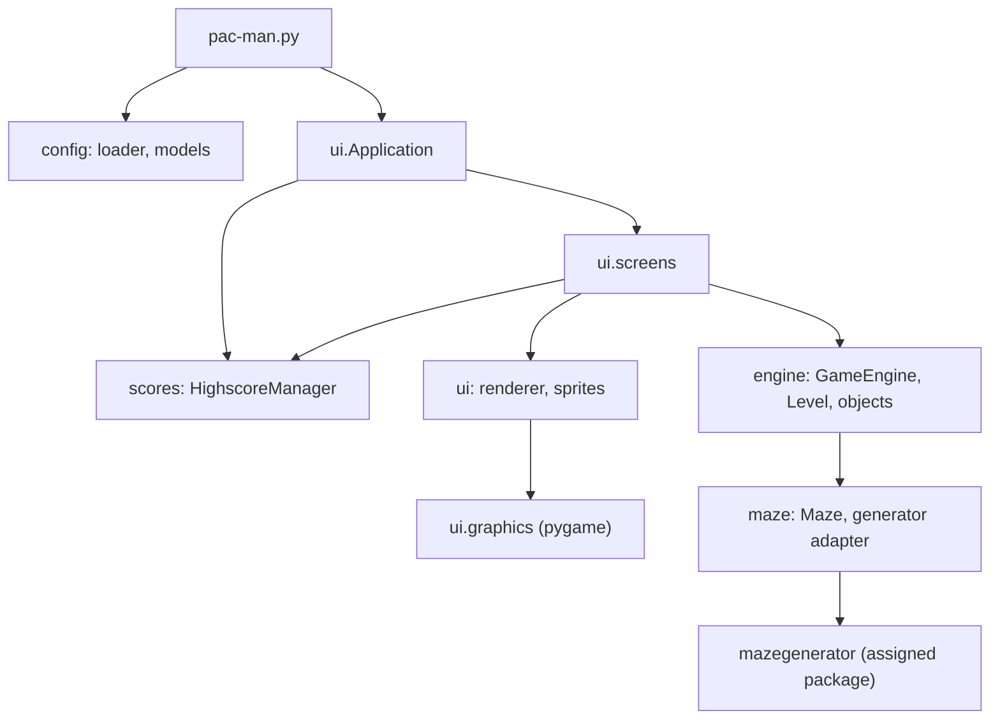

*This project has been created as part of the 42 curriculum by avally, dazema.*

# Pac-Man

## Description

A playable recreation of the arcade game Pac-Man, written in Python with
object-oriented code and a modular architecture.

The player crosses a maze, eats every pacgum, and avoids four ghosts. The
four large pacgums in the corners (super-pacgums) make the ghosts edible for
a short time. The game has 10 levels with growing mazes, a time limit per
level, lives, a score, a persistent top-10 highscore table, and a menu
system. Mazes are produced by an external maze generator package assigned
to the project (see [Maze Generation](#maze-generation)).

Graphics use `pygame`, restricted to a small set of operations that have an
equivalent in the MiniLibX (MLX) library (see [Implementation](#implementation)).

**Main features**

- Configuration file in JSON with comments, strictly validated.
- Levels generated with the assigned maze package, validated before use.
- Main menu, options screen, game screen with HUD, win and game-over screens.
- Persistent top-10 highscores with name entry.
- Sprites drawn pixel by pixel at start of each level (no image files).

## Instructions

### Requirements

- Python 3.12 or later
- [uv](https://docs.astral.sh/uv/) (recommended), or `pip` and `venv`
- A display (the game opens a window the size of the screen)

### Installation

```
make install
```

This runs `uv sync`, which installs the dependencies, including the assigned
maze package from `packages/mazegenerator-2.1.0-py3-none-any.whl`.

Without `uv`:

```
python3 -m venv .venv
. .venv/bin/activate
pip install packages/mazegenerator-2.1.0-py3-none-any.whl pydantic pygame flake8 mypy pytest
```

### Running

```
make run                      # uses config.json
make run CONFIG=my_conf.json  # another configuration file
python3 pac-man.py config.json  # same thing, from an activated virtualenv
```

The program takes exactly one argument: the configuration file. Any problem
with it (missing file, invalid JSON, invalid value) prints a clear message
and stops, with no Python traceback.

### Developer commands

| Command | What it does |
|---|---|
| `make debug` | Runs the game under the Python debugger (`pdb`) |
| `make lint` | `flake8 .` and `mypy .` with the project flags |
| `make lint-strict` | `flake8 .` and `mypy . --strict` |
| `make test` | Runs the `pytest` tests in `tests/` |
| `make clean` | Removes `__pycache__`, `.mypy_cache`, `.pytest_cache`, build folders |

### Controls

| Where | Keys |
|---|---|
| Menus | Up / Down (or W / S in the main menu) to move, Enter to choose, Escape to go back |
| Options | Up / Down to choose a setting, Left / Right to change it, Escape to go back |
| In game | Arrow keys to choose a direction. Escape returns to the main menu |
| Name entry (end of game) | Letters, digits and Space (10 characters max), Backspace to erase, Enter to save, Escape to skip |

Pac-Man keeps moving in his current direction. A direction pressed while a
wall is in the way is remembered and taken as soon as the maze allows it.

## Configuration

The file given on the command line is JSON. Lines whose first non-space
characters are `#` or `//` are comments and are ignored. Unknown keys are
ignored. **Every key below is required**, and the program stops with a
message listing each problem if a key is missing or invalid.

| Key | Type | Allowed values | Default (`config.json`) | Meaning |
|---|---|---|---|---|
| `level_1_seed` | integer | 0 to 2147483647 | 42 | Seed of the first maze. The same seed gives the same maze. `0` means a random maze (behaviour of the maze package), so use 1 or more for a fixed level |
| `level_1_size` | list of 2 integers | each 11 to 99 | `[15, 15]` | Width and height of level 1, in cells. The game supports square mazes: use two equal values |
| `level_size_increase` | integer | 0 to 8 | 2 | Cells added to each side at every new level |
| `level_count` | integer | 10 or more | 10 | Number of levels |
| `level_max_time` | integer | 30 or more | 600 | Time limit of a level, in seconds |
| `lives` | integer | 1 or more | 3 | Lives at the start of a game |
| `points_per_pacgum` | integer | 10 or more | 10 | Score for a pacgum |
| `points_per_super_pacgum` | integer | 10 or more | 100 | Score for a super-pacgum |
| `points_per_ghosts` | integer | 10 or more | 500 | Score for eating an edible ghost |
| `power_duration` | number | 0 or more | 10.0 | Seconds the ghosts stay edible after a super-pacgum |
| `ghost_respawn_time` | number | 0 or more | 1 | Seconds before an eaten ghost comes back |
| `cheat_mode` | true / false | | false | Enables the cheats used during peer review |
| `highscore_filename_path` | text | not empty | `"highscore.json"` | File holding the highscores |

**Rule across keys:** the last level must fit in 99 cells, so
`max(level_1_size) + level_size_increase * (level_count - 1)` must not exceed 99.

**Design choice: stop on invalid configuration.** The subject suggests
replacing invalid values with defaults and continuing. We chose to refuse an
invalid file instead: a typo silently replaced by a default would make the
game behave differently from what the file says, and the message tells the
user exactly what to fix. Validation is done with a `pydantic` model in
`src/config/models.py`, and the loader in `src/config/loader.py` turns every
failure into one readable `ConfigError`.

## Highscore

**How it works.** The table keeps the 10 best scores, each with a player name.
At the end of a game (win or loss), the final score is compared with the
table. If it enters, the player types a name and the table is saved.

- **Name rules:** 1 to 10 characters, ASCII letters, digits and spaces only,
  no space at the start or the end.
- **Score rules:** non-negative integer.
- **Ranking:** best score first. A tie does not push out an older entry, and a
  new score equal to the lowest one in a full table does not enter.
- **File format:** a JSON list of `{"name": ..., "score": ...}` objects, at
  the path given by `highscore_filename_path`.
- **Loading** happens once at start-up and again when the highscore screen is
  opened. **Saving** happens immediately after each new entry.

**Why this design.**

- JSON from the standard library is readable by a human and needs no
  dependency.
- The file is not critical, so a missing, empty or damaged file never stops
  the game: it gives an empty table, or keeps only the valid lines, and a
  warning is logged.
- Saving writes a temporary file and then replaces the real one, so a crash
  during saving cannot leave a half-written file.
- A save failure (read-only folder) is logged and the game continues.
- Names are limited to ASCII because the default font may not draw accents.
- The logic lives in `src/scores/highscores.py`, with no dependency on the
  interface, so it can be tested alone.

## Maze Generation

Mazes come from the assigned `mazegenerator` package, installed unmodified
from `packages/`. We did not write our own generator.

- **Call:** `mazegenerator.MazeGenerator((width, height), perfect=False, seed=seed)`.
  `perfect=False` removes dead ends so corridors suit Pac-Man.
- **Output:** a grid of integers where each bit is a wall of the cell:
  1 = north, 2 = east, 4 = south, 8 = west. A cell with all four walls (15)
  is sealed: it belongs to the "42" pattern drawn in the middle of larger
  mazes and is never part of the playable area.
- **Seeds:** level 1 uses `level_1_seed`. Levels 2 and up use a random seed
  (seed `0`) so each game differs.
- **Size:** level *n* has `level_1_size + level_size_increase * (n - 1)`
  cells per side.

**Adapter and validation (`src/maze/generator.py`).** This is the only file
that knows the package exists. Its job is to refuse anything the game cannot
use, with a `MazeGenerationError` and a message. It checks that:

1. the requested size and seed are valid;
2. the package is installed and does not raise;
3. the result has the requested number of rows and columns, with every value
   an integer from 0 to 15;
4. the outer border is closed;
5. a wall between two cells is the same seen from both sides;
6. every non-sealed cell can be reached from every other.

If the package is replaced (it is re-installed during review) only this file
may need to change.

## Implementation

**Main loop.** `Application.run` repeats: read the events, give them to the
current screen, call the screen's `update` with the elapsed time, clear the
window, call `draw`, show the frame. Time is measured, never assumed, so
the game speed does not depend on the computer.

**Screens.** Every screen derives from `Screen` and implements
`handle_actions`, `update` and `draw`. A screen changes the current screen by
returning its name (`"game"`, `"win"`, `"main_menu"`, ...), so screens do not
need to know each other.

**Game rules.**

- Movement is grid-based: Pac-Man and the ghosts advance one cell every
  0.15 s. The display interpolates between the previous and the current cell
  so the motion looks continuous.
- A level is won when every open cell has been visited. After the last level
  the game is won. Score and lives are kept between levels.
- The level has a countdown. Reaching zero ends the game.
- A super-pacgum makes the ghosts edible for `power_duration` seconds.
- Pac-Man starts in the middle of the maze, the ghosts in the four corners.
  Pac-Man loses a life when a ghost touches him and returns to the middle.

**Graphics and the MLX equivalence rule.** Only `src/ui/graphics.py` imports
`pygame`. It exposes a small, MLX-shaped interface:

| `Graphics` method | MLX counterpart |
|---|---|
| `open_window` | create a window |
| `new_image` | create an image |
| `put_pixel` | write a pixel in an image |
| `put_image` | put an image in the window |
| `draw_string` | draw a string in the window |
| `get_actions` | key and close events |
| `close_window` | destroy the window |
| `clear_window`, `update_window` | clear and refresh the frame |

Helpers with no direct MLX function, kept for layout and compositing:
`get_string_size` (pygame's font is proportional, MLX's is not),
`put_image_in_image` and `draw_cell`. *[TO CONFIRM with staff that these are
accepted.]*

Because MLX cannot resize images, sprites (Pac-Man, ghosts, pellets) are
drawn pixel by pixel in `src/ui/sprites.py` at the size of the current cells,
once per level, and then only placed on the window each frame. The maze is
drawn the same way into one cached image.

**Other points.**

- Errors are turned into clear messages and no traceback is shown.
- Mypy and flake8 are part of `make lint`.
- Window size, cell size and offsets are computed once per level in a
  `MazeLayout` object, which also converts maze coordinates to window pixels.

## General Software Architecture



| Module | Responsibility |
|---|---|
| `pac-man.py` | Entry point: arguments, configuration, start, final error handling |
| `src/config/` | `Config` model (all keys, limits), `ConfigLoader` (reads, strips comments, validates), `ConfigError` |
| `src/maze/` | `Maze` (cells and walls, movement rules), `Cell`, `Direction`; `MazeGenerator` adapter and `MazeGenerationError` |
| `src/engine/` | `GameEngine` (levels, lives, scoring, timers), `Level`, `ObjectSet` and game objects (Pac-Man, ghosts, pellets) |
| `src/ui/` | `Application` (loop, screen switching), screens, `Renderer` and `MazeLayout`, `SpriteBuilder` and `SpriteSet`, `Graphics` |
| `src/scores/` | `HighscoreEntry`, `HighscoreManager` |

**Dependency rule:** arrows go from the interface toward the game rules and
the maze, never back. The maze package knows nothing about the engine, and
only `graphics.py` knows `pygame`.

## Project Management

The project was run by two people, one on the interface and one on the
gameplay, with a written interface contract between the two halves (what the
engine exposes, what the interface sends in). The planning, the risk
analysis, the decisions, the test plan and the blocking points are in
[`project_management/`](project_management/).

## Resources

### References

- Python documentation: <https://docs.python.org/3/> (`json`, `dataclasses`, `logging`, `pdb`, `pathlib`)
- pygame documentation: <https://www.pygame.org/docs/>
- pydantic documentation: <https://docs.pydantic.dev/>
- uv documentation: <https://docs.astral.sh/uv/>
- flake8: <https://flake8.pycqa.org/> and mypy: <https://mypy.readthedocs.io/>
- PEP 8 and PEP 257: <https://peps.python.org/pep-0008/>, <https://peps.python.org/pep-0257/>
- MiniLibX documentation, to match the allowed graphics operations
- Pac-Man ghost behaviour: *The Pac-Man Dossier* (Jamey Pittman)

### Use of AI

An AI assistant (Claude, by Anthropic) was used during the project:

- **As a mentor and reviewer:** to discuss the architecture, the order of work,
  the design of each module, and to review code and find bugs. Suggestions
  were discussed, and the code was written and adapted by the team.
- **To generate first versions of some modules**, which were then integrated
  and modified by the team:
  - the validation and error handling of the maze adapter (`src/maze/generator.py`);
  - the pixel sprite builder (`src/ui/sprites.py`);
  - the placement of objects on a maze (`ObjectSet`);
  - the highscore system (`src/scores/highscores.py`);
  - the `Makefile`, this README and the templates in `project_management/`.
- *[TO FILL: AI use by each team member on their own parts, and confirmation
  that every generated part was read, understood and tested by the team.]*

## Known limitations

*(Remove each line when it is fixed.)*

- No pause menu and no instructions screen yet.
- Cheat mode is incomplete.
- Ghost behaviour is a first prototype.
- `level_max_time` is not yet used by the level countdown.
- The game currently rewrites the configuration file when it exits.
- `src/engine/objects.py` still imports `pygame` and types from the interface
  (`src/ui/sprites.py`); they should be removed from the engine.